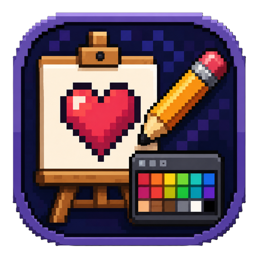

<a id="readme-top"></a>

[](https://github.com/AlexandreColl/PixelArtEditor/releases)
[](https://github.com/AlexandreColl/PixelArtEditor/actions/workflows/ci.yml)
[](LICENSE)
[](https://nodejs.org/)
[](https://pnpm.io/)
[](https://v2.tauri.app/)
[](https://react.dev/)
[](CONTRIBUTING.md)
[](https://github.com/AlexandreColl/PixelArtEditor)

<br />
<div align="center">
  <a href="https://github.com/AlexandreColl/PixelArtEditor">
    
  </a>
  <h1 align="center">Pixel Art Editor</h1>

  <p align="center">
    Editor de pixel art de escritorio con agente IA integrado
    <br />
    <a href="#-funcionalidades"><strong>Explorar funcionalidades »</strong></a>
    <br />
    <br />
    <a href="https://github.com/AlexandreColl/PixelArtEditor/releases/latest">Descargar</a>
    &middot;
    <a href="#-primeros-pasos">Primeros Pasos</a>
    &middot;
    <a href="https://github.com/AlexandreColl/PixelArtEditor/issues/new?labels=bug">Reportar Error</a>
    &middot;
    <a href="https://github.com/AlexandreColl/PixelArtEditor/issues/new?labels=enhancement">Solicitar Funcionalidad</a>
  </p>
</div>

<!-- TABLE OF CONTENTS -->
<details>
  <summary>Tabla de Contenidos</summary>
  <ol>
    <li>
      <a href="#-sobre-el-proyecto">Sobre el Proyecto</a>
      <ul>
        <li><a href="#construido-con">Construido Con</a></li>
      </ul>
    </li>
    <li>
      <a href="#-primeros-pasos">Primeros Pasos</a>
      <ul>
        <li><a href="#descarga">Descarga</a></li>
        <li><a href="#requisitos">Requisitos</a></li>
        <li><a href="#instalación">Instalación</a></li>
      </ul>
    </li>
    <li><a href="#-uso">Uso</a></li>
    <li><a href="#-atajos-de-teclado">Atajos de Teclado</a></li>
    <li><a href="#-desarrollo">Desarrollo</a></li>
    <li><a href="#-estructura-del-proyecto">Estructura del Proyecto</a></li>
    <li><a href="#-roadmap">Roadmap</a></li>
    <li><a href="#-contribuir">Contribuir</a></li>
    <li><a href="#-licencia">Licencia</a></li>
    <li><a href="#-contacto">Contacto</a></li>
  </ol>
</details>

<!-- ABOUT THE PROJECT -->

## 🎨 Sobre el Proyecto

Pixel Art Editor es una aplicación de escritorio para crear y editar pixel art, sprites y assets para videojuegos. Está construida con **Tauri** + **React** + **TypeScript**, lo que resulta en un binario pequeño, rápido y nativo.

El editor ofrece herramientas esenciales de dibujo (lápiz, borrador, bote de pintura, selector de color, selección y sombreado), historia completa de deshacer/rehacer, y la posibilidad de abrir y guardar archivos PNG directamente desde el sistema de archivos.

Además, incluye un **panel de IA** que permite modificar el arte mediante lenguaje natural usando modelos con visión de **OpenAI**, **Anthropic** o **Google Gemini**, ideal para iterar rápido sin necesidad de editar píxel por píxel.

Características principales:

- :pencil2: Herramientas completas: lápiz, borrador, relleno, selector de color, selección, sombreado y pincel de tamaño ajustable
- :floppy_disk: Abre y guarda PNG reales directamente en tu disco
- :framed_picture: Convierte cualquier imagen o foto en pixel art: tamaño, número de colores, dithering y vista previa en vivo
- :robot: Agente IA integrado que entiende tu arte y lo modifica con lenguaje natural
- :arrows_counterclockwise: Historia ilimitada de deshacer/rehacer (Ctrl+Z / Ctrl+Shift+Z)
- :mag: Zoom y paneo con rueda del ratón (clic central)
- :rainbow: Paleta de colores con colores primario/secundario (clic izquierdo / derecho) y muestras predefinidas

<p align="right">(<a href="#readme-top">volver arriba</a>)</p>

### Construido Con

- [](https://v2.tauri.app/)
- [](https://react.dev/)
- [](https://www.typescriptlang.org/)
- [](https://vitejs.dev/)
- [](https://www.rust-lang.org/)
- [](https://pnpm.io/)
- [](https://lucide.dev/)
- [](https://openai.com/)
- [](https://www.anthropic.com/)
- [](https://ai.google.dev/)

<p align="right">(<a href="#readme-top">volver arriba</a>)</p>

<!-- GETTING STARTED -->

## 🚀 Primeros Pasos

### Descarga

Los instaladores para Windows, macOS y Linux están disponibles en la página de [Releases](https://github.com/AlexandreColl/PixelArtEditor/releases/latest).

Si prefieres compilarlo desde el código fuente, sigue estos pasos.

### Requisitos

- **Node.js** v18 o superior
- **pnpm**
  ```sh
  npm install -g pnpm
  ```
- **Rust** (instalar via [rustup.rs](https://rustup.rs/))
- **Visual Studio Build Tools 2022** con el workload "Desarrollo de escritorio con C++" (solo Windows)

### Instalación

1. Clona el repositorio
   ```sh
   git clone https://github.com/AlexandreColl/PixelArtEditor.git
   cd PixelArtEditor
   ```
2. Instala las dependencias de JavaScript
   ```sh
   pnpm install
   ```
3. Inicia en modo desarrollo
   ```sh
   pnpm run tauri:dev
   ```

> [!NOTE]
> En Windows, `pnpm run tauri:dev` configura automáticamente el entorno de Visual Studio C++. Si ejecutas `pnpm tauri dev` directamente, usa la "Developer Command Prompt for VS 2022".

<p align="right">(<a href="#readme-top">volver arriba</a>)</p>

<!-- USAGE -->

## 🎮 Uso

### Herramientas

| Icono          | Herramienta       | Descripción                                      |
| -------------- | ----------------- | ------------------------------------------------ |
| `Pencil`       | Lápiz             | Dibuja píxel a píxel con el color primario       |
| `Eraser`       | Borrador          | Elimina píxeles (los deja transparentes)         |
| `PaintBucket`  | Bote de pintura   | Rellena una región conectada del mismo color     |
| `Pipette`      | Selector de color | Captura el color de un píxel                     |
| `Slash`        | Línea             | Arrastra para dibujar una línea recta            |
| `Square`       | Rectángulo        | Arrastra para dibujar un rectángulo              |
| `Circle`       | Elipse            | Arrastra para dibujar una elipse                 |
| `Blend`        | Sombreado         | Difumina mezclando colores de píxeles adyacentes |
| `MousePointer` | Selección         | Selecciona una región rectangular                |

### Tamaño de pincel

Botones **+** / **−** en la barra lateral para ajustar el tamaño del pincel (1–16). Aplica a lápiz, borrador y al contorno de línea, rectángulo y elipse.

### Dibujo simétrico

Los botones `FlipHorizontal` y `FlipVertical` de la barra lateral activan el espejo horizontal y/o vertical (pueden combinarse). Mientras estén activos se dibuja la copia reflejada respecto al centro del lienzo, que se marca con una línea discontinua. Afecta a lápiz, borrador y formas, y no al relleno, al cuentagotas ni al sombreado. Cada trazo, con su reflejo, se deshace de una vez.

### Formas

Las formas se previsualizan mientras arrastras y se deshacen con un solo `Ctrl+Z`. El clic izquierdo usa el color primario y el derecho el secundario. En rectángulo y elipse, la casilla **Filled** las rellena; en ese caso el tamaño de pincel no se aplica.

### Paneo

Usa el **botón central del ratón** (rueda) para arrastrar la vista.

### Carga y guardado

- **Abrir imagen** — `Ctrl+O` o arrastra un PNG directamente al editor
- **Guardar** — `Ctrl+S` abre el diálogo la primera vez y sobrescribe el archivo original en adelante
- **Ctrl+Shift+S** — equivalente a Ctrl+S
- **Exportar PNG escalado** — botón `ImageDown` junto a Guardar, con escala ×1, ×2, ×4 u ×8. Cada píxel se amplía a un bloque exacto, sin suavizado, y la transparencia se conserva. Es una exportación: no cambia el archivo que tienes abierto

### Convertir una imagen en pixel art

Al abrir o arrastrar una imagen grande (más de 128 px) o con muchos colores, como una foto, aparece el diálogo **Convert to pixel art**. Para convertir también imágenes pequeñas, usa el botón `ImagePlus` (**Import image as pixel art**).

| Opción                 | Descripción                                                                                                              |
| ---------------------- | ------------------------------------------------------------------------------------------------------------------------ |
| Size                   | Lado largo del resultado (16–256 px), manteniendo la proporción. Cada píxel es la media del bloque de la imagen original |
| Colors                 | Tamaño máximo de la paleta (2–64), calculada a partir de la propia imagen                                                |
| Dithering              | Difusión de error Floyd–Steinberg para simular degradados con pocos colores                                              |
| Transparency threshold | Solo en imágenes con transparencia: los píxeles por debajo del umbral quedan transparentes y el resto opacos             |

**Convert** importa el resultado, que se guarda como un archivo nuevo (`<nombre>-pixel.png`) sin sobrescribir el original. **Open original** abre la imagen sin convertir; solo está disponible hasta 512 px para no bloquear el editor.

### Agente IA

1. Abre el panel IA con el botón `BotMessageSquare` en la esquina superior derecha
2. Elige el proveedor (OpenAI, Anthropic o Gemini) y el modelo, e introduce tu clave de API (se guarda localmente)
3. (Opcional) Selecciona una región con la herramienta `MousePointer`; sin selección se edita todo el lienzo
4. Describe el cambio que quieres (ej: "haz el fondo azul" o "duplica este sprite")
5. Revisa el resultado y haz clic en **Aplicar Edición**

<p align="right">(<a href="#readme-top">volver arriba</a>)</p>

<!-- KEYBOARD SHORTCUTS -->

## ⌨️ Atajos de Teclado

| Tecla                     | Acción                          |
| ------------------------- | ------------------------------- |
| `Ctrl+Z`                  | Deshacer                        |
| `Ctrl+Shift+Z` / `Ctrl+Y` | Rehacer                         |
| `Ctrl+S`                  | Guardar PNG                     |
| `Ctrl+O`                  | Abrir imagen                    |
| `G`                       | Mostrar u ocultar la cuadrícula |
| `Ctrl+0`                  | Ajustar el lienzo a la ventana  |

<p align="right">(<a href="#readme-top">volver arriba</a>)</p>

<!-- DEVELOPMENT -->

## 🛠️ Desarrollo

### Build producción

```sh
pnpm run tauri:build
```

El ejecutable se genera en `src-tauri/target/release/app.exe`. También se crean instaladores MSI y NSIS en la carpeta `bundle/`.

### Scripts disponibles

| Comando                 | Descripción                                            |
| ----------------------- | ------------------------------------------------------ |
| `pnpm run dev`          | Servidor de desarrollo Vite (solo frontend, sin Tauri) |
| `pnpm run build`        | Compila TypeScript + Vite                              |
| `pnpm run tauri:dev`    | Inicia en modo desarrollo con recarga en caliente      |
| `pnpm run tauri:build`  | Compila el binario de producción                       |
| `pnpm run format`       | Formatea el código con Prettier                        |
| `pnpm run format:check` | Comprueba el formato (usado en CI)                     |

### Windows

Puedes hacer doble clic en `build.bat` o `dev.bat` para compilar o ejecutar sin abrir la terminal.

<p align="right">(<a href="#readme-top">volver arriba</a>)</p>

<!-- PROJECT STRUCTURE -->

## 📁 Estructura del Proyecto

```
pixel-art-editor/
├── src/                        # Frontend React
│   ├── components/             # Canvas, Toolbar, ColorPalette, AIChat, ConvertDialog
│   │   ├── Canvas.tsx          # Lienzo con zoom, grid y dibujo
│   │   ├── Toolbar.tsx         # Barra de herramientas
│   │   ├── ColorPalette.tsx    # Selector de colores
│   │   └── AIChat.tsx          # Panel de chat con IA
│   ├── hooks/
│   │   └── useEditor.ts        # Estado global, herramientas e historial
│   ├── ai/
│   │   ├── openai.ts           # Cliente OpenAI (visión + JSON)
│   │   ├── anthropic.ts        # Cliente Anthropic
│   │   └── gemini.ts           # Cliente Google Gemini
│   ├── types/
│   │   └── index.ts            # Tipos compartidos
│   └── App.tsx                 # Layout principal y lógica de guardado
├── src-tauri/                  # Backend Rust (Tauri)
│   ├── src/
│   │   └── lib.rs              # Comandos Tauri (save_png_file)
│   ├── capabilities/
│   │   └── default.json        # Permisos de plugins
│   ├── icons/                  # Iconos de la aplicación
│   └── tauri.conf.json         # Configuración de ventana y build
├── .github/                    # CI, workflow de release y plantillas
├── scripts/
│   └── dev.ps1                 # Helper que configura VS + Node + Cargo
├── .npmrc                      # Configuración de pnpm (shamefully-hoist)
├── build.bat                   # Build con un clic
├── dev.bat                     # Dev con un clic
├── CHANGELOG.md                # Historial de versiones
├── CONTRIBUTING.md             # Guía de contribución y flujo de ramas
├── LICENSE
└── package.json
```

<p align="right">(<a href="#readme-top">volver arriba</a>)</p>

<!-- ROADMAP -->

## 🗺️ Roadmap

### ✅ 0.1 — Primera versión

- [x] Herramientas básicas de dibujo: lápiz, borrador, relleno, cuentagotas, sombreado y selección
- [x] Tamaño de pincel ajustable y colores primario/secundario
- [x] Deshacer/rehacer con historial
- [x] Abrir y guardar PNG
- [x] Panel de IA multiproveedor (OpenAI, Anthropic, Gemini)

### 0.2 — Herramientas

- [x] Convertir imágenes a pixel art (tamaño, colores, dithering y vista previa)
- [x] Herramientas de línea, rectángulo y elipse
- [ ] Mover, copiar y pegar la selección
- [x] Dibujo simétrico (espejo horizontal/vertical)
- [x] Mostrar u ocultar la cuadrícula y ajustar el lienzo a la ventana

### 0.3 — Paletas y exportación

- [ ] Importar y exportar paletas (`.gpl`, `.hex`)
- [ ] Bloquear el dibujo a la paleta activa
- [x] Exportar PNG escalado (×2, ×4, ×8)
- [ ] Exportar sprite sheet

### 0.4 — Animación

- [ ] Varios fotogramas por proyecto
- [ ] Papel cebolla (fotograma anterior en transparencia)
- [ ] Vista previa de la animación
- [ ] Exportar a GIF

### 0.5 — Capas y proyectos

- [ ] Capas con visibilidad y opacidad
- [ ] Formato de proyecto propio que conserve capas y fotogramas
- [ ] Autoguardado

### 1.0 — Estable

- [ ] Atajos de teclado personalizables
- [ ] Política de seguridad de contenido (CSP) activada
- [ ] Instaladores firmados
- [ ] Actualizaciones automáticas

### Más adelante

- [ ] Plugins / scripting
- [ ] Edición con modelos de imagen generativa

¿Tienes una idea? [Solicita una funcionalidad](https://github.com/AlexandreColl/PixelArtEditor/issues/new?labels=enhancement).

<p align="right">(<a href="#readme-top">volver arriba</a>)</p>

<!-- CONTRIBUTING -->

## 🤝 Contribuir

Las contribuciones hacen que la comunidad open source sea un lugar increíble para aprender, inspirar y crear. **Cualquier contribución que hagas será muy apreciada.**

Si tienes una sugerencia que mejore el proyecto, por favor haz un fork del repositorio y crea un pull request contra la rama `develop`. También puedes abrir un issue con la etiqueta "enhancement". Consulta [CONTRIBUTING.md](CONTRIBUTING.md) para conocer el flujo de ramas y el proceso de release.

1. Haz un Fork del Proyecto
2. Crea tu Rama de Funcionalidad desde `develop` (`git checkout -b feature/AmazingFeature develop`)
3. Commit tus Cambios (`git commit -m 'feat: add some amazing feature'`)
4. Push a la Rama (`git push origin feature/AmazingFeature`)
5. Abre un Pull Request contra `develop`

<p align="right">(<a href="#readme-top">volver arriba</a>)</p>

<!-- LICENSE -->

## 📄 Licencia

Distribuido bajo la licencia MIT. Consulta [`LICENSE`](LICENSE) para más información. Los cambios de cada versión están en el [`CHANGELOG`](CHANGELOG.md).

<p align="right">(<a href="#readme-top">volver arriba</a>)</p>

<!-- CONTACT -->

## 📫 Contacto

Alexandre Coll Molina - [LinkedIn](https://www.linkedin.com/in/alexandre-coll-molina/)

Project Link: [https://github.com/AlexandreColl/PixelArtEditor](https://github.com/AlexandreColl/PixelArtEditor)

<p align="right">(<a href="#readme-top">volver arriba</a>)</p>
