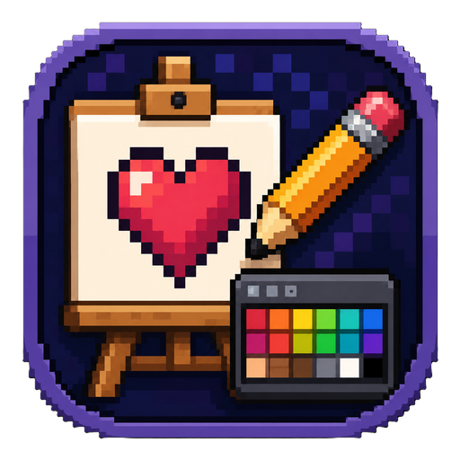

<a id="readme-top"></a>

[](https://github.com/AlexandreColl/PixelArtEditor/releases)
[](https://github.com/AlexandreColl/PixelArtEditor/actions/workflows/ci.yml)
[](LICENSE)
[](https://nodejs.org/)
[](https://pnpm.io/)
[](https://v2.tauri.app/)
[](https://react.dev/)
[](CONTRIBUTING.md)
[](https://github.com/AlexandreColl/PixelArtEditor)

<br />
<div align="center">
  <a href="https://github.com/AlexandreColl/PixelArtEditor">
    
  </a>
  <h1 align="center">Pixel Art Editor</h1>

  <p align="center">
    Editor de pixel art de escritorio con agente IA integrado
    <br />
    <a href="#-funcionalidades"><strong>Explorar funcionalidades »</strong></a>
    <br />
    <br />
    <a href="https://github.com/AlexandreColl/PixelArtEditor/releases/latest">Descargar</a>
    &middot;
    <a href="#-primeros-pasos">Primeros Pasos</a>
    &middot;
    <a href="https://github.com/AlexandreColl/PixelArtEditor/issues/new?labels=bug">Reportar Error</a>
    &middot;
    <a href="https://github.com/AlexandreColl/PixelArtEditor/issues/new?labels=enhancement">Solicitar Funcionalidad</a>
  </p>
</div>

<!-- TABLE OF CONTENTS -->
<details>
  <summary>Tabla de Contenidos</summary>
  <ol>
    <li>
      <a href="#-sobre-el-proyecto">Sobre el Proyecto</a>
      <ul>
        <li><a href="#construido-con">Construido Con</a></li>
      </ul>
    </li>
    <li>
      <a href="#-primeros-pasos">Primeros Pasos</a>
      <ul>
        <li><a href="#descarga">Descarga</a></li>
        <li><a href="#requisitos">Requisitos</a></li>
        <li><a href="#instalación">Instalación</a></li>
      </ul>
    </li>
    <li><a href="#-uso">Uso</a></li>
    <li><a href="#-atajos-de-teclado">Atajos de Teclado</a></li>
    <li><a href="#-desarrollo">Desarrollo</a></li>
    <li><a href="#-estructura-del-proyecto">Estructura del Proyecto</a></li>
    <li><a href="#-roadmap">Roadmap</a></li>
    <li><a href="#-contribuir">Contribuir</a></li>
    <li><a href="#-licencia">Licencia</a></li>
    <li><a href="#-contacto">Contacto</a></li>
  </ol>
</details>

<!-- ABOUT THE PROJECT -->

## 🎨 Sobre el Proyecto

Pixel Art Editor es una aplicación de escritorio para crear y editar pixel art, sprites y assets para videojuegos. Está construida con **Tauri** + **React** + **TypeScript**, lo que resulta en un binario pequeño, rápido y nativo.

El editor ofrece herramientas esenciales de dibujo (lápiz, borrador, bote de pintura, selector de color, selección y sombreado), historia completa de deshacer/rehacer, y la posibilidad de abrir y guardar archivos PNG directamente desde el sistema de archivos.

Además, incluye un **panel de IA** que permite modificar el arte mediante lenguaje natural usando modelos con visión de **OpenAI**, **Anthropic** o **Google Gemini**, ideal para iterar rápido sin necesidad de editar píxel por píxel.

Características principales:

- :pencil2: Herramientas completas: lápiz, borrador, relleno, selector de color, selección, sombreado y pincel de tamaño ajustable
- :floppy_disk: Abre y guarda PNG reales directamente en tu disco
- :framed_picture: Convierte cualquier imagen o foto en pixel art: tamaño, número de colores, dithering y vista previa en vivo
- :robot: Agente IA integrado que entiende tu arte y lo modifica con lenguaje natural
- :arrows_counterclockwise: Historia ilimitada de deshacer/rehacer (Ctrl+Z / Ctrl+Shift+Z)
- :mag: Zoom y paneo con rueda del ratón (clic central)
- :rainbow: Paleta editable con colores primario/secundario (clic izquierdo / derecho), que se recuerda entre sesiones
- :art: Importación y exportación de paletas `.gpl` (GIMP, Aseprite, Krita) y `.hex` (Lospec), y bloqueo del dibujo a la paleta
- :film_strip: Animación por fotogramas con papel cebolla y vista previa, exportable a GIF o sprite sheet

<p align="right">(<a href="#readme-top">volver arriba</a>)</p>

### Construido Con

- [](https://v2.tauri.app/)
- [](https://react.dev/)
- [](https://www.typescriptlang.org/)
- [](https://vitejs.dev/)
- [](https://www.rust-lang.org/)
- [](https://pnpm.io/)
- [](https://lucide.dev/)
- [](https://openai.com/)
- [](https://www.anthropic.com/)
- [](https://ai.google.dev/)

<p align="right">(<a href="#readme-top">volver arriba</a>)</p>

<!-- GETTING STARTED -->

## 🚀 Primeros Pasos

### Descarga

Los instaladores para Windows, macOS y Linux están disponibles en la página de [Releases](https://github.com/AlexandreColl/PixelArtEditor/releases/latest).

Si prefieres compilarlo desde el código fuente, sigue estos pasos.

### Requisitos

- **Node.js** v24 o superior (recomendado: la LTS actual, v26)
- **pnpm** 12 (la versión exacta está fijada en `packageManager` de `package.json`)
  ```sh
  npm install -g pnpm@12
  ```
- **Rust** 1.90 o superior (instalar via [rustup.rs](https://rustup.rs/))
- **Visual Studio Build Tools 2022** con el workload "Desarrollo de escritorio con C++" (solo Windows)

### Instalación

1. Clona el repositorio
   ```sh
   git clone https://github.com/AlexandreColl/PixelArtEditor.git
   cd PixelArtEditor
   ```
2. Instala las dependencias de JavaScript
   ```sh
   pnpm install
   ```
3. Inicia en modo desarrollo
   ```sh
   pnpm run tauri:dev
   ```

> [!NOTE]
> En Windows, `pnpm run tauri:dev` configura automáticamente el entorno de Visual Studio C++. Si ejecutas `pnpm tauri dev` directamente, usa la "Developer Command Prompt for VS 2022".

<p align="right">(<a href="#readme-top">volver arriba</a>)</p>

<!-- USAGE -->

## 🎮 Uso

### Herramientas

| Tecla | Herramienta       | Descripción                                      |
| ----- | ----------------- | ------------------------------------------------ |
| `B`   | Lápiz             | Dibuja píxel a píxel con el color primario       |
| `E`   | Borrador          | Elimina píxeles (los deja transparentes)         |
| `F`   | Bote de pintura   | Rellena una región conectada del mismo color     |
| `I`   | Selector de color | Captura el color de un píxel                     |
| `L`   | Línea             | Arrastra para dibujar una línea recta            |
| `R`   | Rectángulo        | Arrastra para dibujar un rectángulo              |
| `O`   | Elipse            | Arrastra para dibujar una elipse                 |
| `S`   | Sombreado         | Difumina mezclando colores de píxeles adyacentes |
| `M`   | Selección         | Selecciona una región rectangular                |

Al pasar el ratón por un botón aparece su nombre y su atajo. Sobre el lienzo, un contorno marca los píxeles que pintará la herramienta (con el tamaño de pincel y el espejo aplicados), y la barra de estado muestra las coordenadas y el color del píxel bajo el cursor y el tamaño de la selección. Las zonas transparentes se ven como un fondo de cuadros.

### Tamaño de pincel

Botones **+** / **−** en la barra lateral para ajustar el tamaño del pincel (1–16). Aplica a lápiz, borrador y al contorno de línea, rectángulo y elipse.

### Selección: mover, copiar y pegar

Con la herramienta `MousePointer`, arrastra para seleccionar una región rectangular. Un clic sin arrastrar, o `Esc`, la deselecciona.

| Acción                  | Cómo                                                                                      |
| ----------------------- | ----------------------------------------------------------------------------------------- |
| Mover                   | Arrastra desde dentro de la selección. Se queda dentro del lienzo y se deshace de una vez |
| Copiar al arrastrar     | Mantén `Alt` mientras arrastras                                                           |
| Mover 1 píxel           | Flechas del teclado                                                                       |
| Copiar / Cortar / Pegar | `Ctrl+C` / `Ctrl+X` / `Ctrl+V`, o los botones que aparecen con la herramienta activa      |
| Borrar                  | `Supr`                                                                                    |
| Seleccionar todo        | `Ctrl+A`                                                                                  |

Los píxeles transparentes de lo que se mueve o pega no tapan lo que hay debajo. Al pegar, la copia aparece en la esquina superior izquierda de la selección (o del lienzo) y queda seleccionada, lista para arrastrarla. El portapapeles es interno del editor: no se comparte con otras aplicaciones.

### Dibujo simétrico

Los botones `FlipHorizontal` y `FlipVertical` de la barra lateral activan el espejo horizontal y/o vertical (pueden combinarse). Mientras estén activos se dibuja la copia reflejada respecto al centro del lienzo, que se marca con una línea discontinua. Afecta a lápiz, borrador y formas, y no al relleno, al cuentagotas ni al sombreado. Cada trazo, con su reflejo, se deshace de una vez.

### Paleta

Arriba del panel derecho están los colores primario (delante) y secundario (detrás); el botón de flechas o `X` los intercambia. Debajo, el selector de color edita el primario: el cuadro elige saturación y brillo, la barra el tono, y el campo **Hex** acepta `#rgb` o `#rrggbb`, con o sin `#` (Enter aplica, Esc descarta).

Más abajo está la paleta activa, con su nombre y número de colores. Se guarda entre sesiones.

| Acción                   | Cómo                                                                                                    |
| ------------------------ | ------------------------------------------------------------------------------------------------------- |
| Elegir color             | Clic izquierdo (primario) o derecho (secundario) en una muestra                                         |
| Añadir color             | Botón `+`: añade el color primario                                                                      |
| Quitar color             | `Ctrl+clic` en la muestra                                                                               |
| Reordenar                | Arrastra una muestra sobre otra                                                                         |
| Importar / exportar      | Botones de archivo: `.gpl` (GIMP, Aseprite, Krita) y `.hex` ([Lospec](https://lospec.com/palette-list)) |
| Restaurar la predefinida | Botón de deshacer circular                                                                              |
| Bloquear a la paleta     | Botón del candado                                                                                       |
| Reducir a la paleta      | Botón de la varita                                                                                      |

Con la paleta **bloqueada**, todo lo que se dibuja usa el color de la paleta más cercano: el selector de color y el cuentagotas se ajustan a ella, y lo mismo ocurre con el sombreado y con los resultados del agente IA.

**Reducir a la paleta** cambia cada píxel de la selección (o, si no hay selección, de todos los fotogramas) por el color de la paleta más cercano, en un solo paso que se deshace con `Ctrl+Z`.

### Formas

Las formas se previsualizan mientras arrastras y se deshacen con un solo `Ctrl+Z`. El clic izquierdo usa el color primario y el derecho el secundario. En rectángulo y elipse, la casilla **Filled** las rellena; en ese caso el tamaño de pincel no se aplica.

### Animación

La tira de fotogramas está bajo el lienzo. Cada fotograma se dibuja por separado; todos comparten tamaño y paleta.

| Acción               | Cómo                                                                                |
| -------------------- | ----------------------------------------------------------------------------------- |
| Nuevo fotograma      | Botón `+` (vacío) o duplicar (copia del actual), que se inserta detrás del actual   |
| Cambiar de fotograma | Clic en la miniatura, o `,` y `.` para el anterior y el siguiente                   |
| Reordenar            | Arrastra la miniatura                                                               |
| Borrar               | Botón de papelera (siempre queda al menos uno)                                      |
| Papel cebolla        | Botón de capas: muestra el fotograma anterior en rojo y transparente bajo el actual |
| Reproducir           | Botón de play o `P`. La velocidad se ajusta en fps (1–60)                           |

Deshacer y rehacer funcionan sobre toda la animación: si lo que se deshace está en otro fotograma, el editor salta a él.

La vista previa de la izquierda reproduce la animación sin dejar de editar. Un clic sobre ella alterna entre tamaño real y ampliado.

### Paneo

Usa el **botón central del ratón** (rueda) para arrastrar la vista.

### Carga y guardado

Las acciones de archivo están en el menú **File** de la cabecera; junto a él queda el botón de guardar.

- **Nuevo lienzo** — **File → New canvas**, de 32×32
- **Abrir imagen** — `Ctrl+O`, **File → Open…** o arrastra un PNG directamente al editor
- **Guardar** — `Ctrl+S` o el botón de guardar: abre el diálogo la primera vez y sobrescribe el archivo original en adelante. Con varios fotogramas se guardan todos en fila en el mismo PNG, junto con la velocidad, y al abrirlo vuelven a ser fotogramas. Cualquier otro programa lo ve como un sprite sheet normal
- **Ctrl+Shift+S** — equivalente a Ctrl+S
- **Exportar** — `Ctrl+E` o **File → Export…**: el fotograma actual en PNG, un sprite sheet en PNG (con las columnas que elijas) o un GIF animado, a escala ×1, ×2, ×4 u ×8. Cada píxel se amplía a un bloque exacto, sin suavizado. Es una exportación: no cambia el archivo que tienes abierto. El GIF no admite transparencia parcial, así que los píxeles semitransparentes quedan opacos o transparentes
- **Importar sprite sheet** — **File → Import sprite sheet…**: indica el tamaño de cada fotograma y una cuadrícula muestra cómo se cortará la imagen. Las celdas vacías del final se descartan

### Convertir una imagen en pixel art

Al abrir o arrastrar una imagen grande (más de 128 px) o con muchos colores, como una foto, aparece el diálogo **Convert to pixel art**. Para convertir también imágenes pequeñas, usa **File → Import image as pixel art…**.

| Opción                 | Descripción                                                                                                              |
| ---------------------- | ------------------------------------------------------------------------------------------------------------------------ |
| Size                   | Lado largo del resultado (16–256 px), manteniendo la proporción. Cada píxel es la media del bloque de la imagen original |
| Colors                 | Tamaño máximo de la paleta (2–64), calculada a partir de la propia imagen                                                |
| Dithering              | Difusión de error Floyd–Steinberg para simular degradados con pocos colores                                              |
| Transparency threshold | Solo en imágenes con transparencia: los píxeles por debajo del umbral quedan transparentes y el resto opacos             |

**Convert** importa el resultado, que se guarda como un archivo nuevo (`<nombre>-pixel.png`) sin sobrescribir el original. **Open original** abre la imagen sin convertir; solo está disponible hasta 512 px para no bloquear el editor.

### Agente IA

1. Abre el panel IA con el botón `BotMessageSquare` en la esquina superior derecha
2. Elige el proveedor (OpenAI, Anthropic o Gemini) y el modelo, e introduce tu clave de API (se guarda localmente)
3. (Opcional) Selecciona una región con la herramienta `MousePointer`; sin selección se edita todo el lienzo
4. Describe el cambio que quieres (ej: "haz el fondo azul" o "duplica este sprite")
5. Revisa el resultado y haz clic en **Aplicar Edición**

<p align="right">(<a href="#readme-top">volver arriba</a>)</p>

<!-- KEYBOARD SHORTCUTS -->

## ⌨️ Atajos de Teclado

| Tecla                               | Acción                                            |
| ----------------------------------- | ------------------------------------------------- |
| `B` `E` `F` `I` `L` `R` `O` `S` `M` | Elegir herramienta (ver la tabla de herramientas) |
| `X`                                 | Intercambiar colores primario y secundario        |
| `,` / `.`                           | Fotograma anterior / siguiente                    |
| `P`                                 | Reproducir o parar la animación                   |
| `Ctrl+Z`                            | Deshacer                                          |
| `Ctrl+Shift+Z` / `Ctrl+Y`           | Rehacer                                           |
| `Ctrl+S`                            | Guardar PNG                                       |
| `Ctrl+O`                            | Abrir imagen                                      |
| `Ctrl+E`                            | Exportar (PNG, sprite sheet o GIF)                |
| `G`                                 | Mostrar u ocultar la cuadrícula                   |
| `Ctrl+0`                            | Ajustar el lienzo a la ventana                    |
| `Ctrl+C` / `Ctrl+X` / `Ctrl+V`      | Copiar, cortar y pegar la selección               |
| `Ctrl+A`                            | Seleccionar todo                                  |
| `Supr`                              | Borrar la selección                               |
| `Esc`                               | Deseleccionar                                     |
| Flechas                             | Mover la selección 1 píxel                        |

<p align="right">(<a href="#readme-top">volver arriba</a>)</p>

<!-- DEVELOPMENT -->

## 🛠️ Desarrollo

### Build producción

```sh
pnpm run tauri:build
```

El ejecutable se genera en `src-tauri/target/release/app.exe`. También se crean instaladores MSI y NSIS en la carpeta `bundle/`.

### Scripts disponibles

| Comando                 | Descripción                                            |
| ----------------------- | ------------------------------------------------------ |
| `pnpm run dev`          | Servidor de desarrollo Vite (solo frontend, sin Tauri) |
| `pnpm run build`        | Compila TypeScript + Vite                              |
| `pnpm run tauri:dev`    | Inicia en modo desarrollo con recarga en caliente      |
| `pnpm run tauri:build`  | Compila el binario de producción                       |
| `pnpm run format`       | Formatea el código con Prettier                        |
| `pnpm run format:check` | Comprueba el formato (usado en CI)                     |
| `pnpm test`             | Ejecuta los tests una vez (usado en CI)                |
| `pnpm run test:watch`   | Ejecuta los tests en modo watch                        |

### Windows

Puedes hacer doble clic en `build.bat` o `dev.bat` para compilar o ejecutar sin abrir la terminal.

<p align="right">(<a href="#readme-top">volver arriba</a>)</p>

<!-- PROJECT STRUCTURE -->

## 📁 Estructura del Proyecto

```
pixel-art-editor/
├── src/                        # Frontend React
│   ├── components/             # Canvas, Toolbar, ColorPalette, AIChat, ConvertDialog, FileMenu…
│   │   ├── Canvas.tsx          # Lienzo con zoom, grid y dibujo
│   │   ├── Toolbar.tsx         # Barra de herramientas
│   │   ├── ColorPalette.tsx    # Colores actuales y paleta editable
│   │   ├── FileMenu.tsx        # Menú File: nuevo, abrir, importar, guardar y exportar
│   │   ├── Timeline.tsx        # Tira de fotogramas
│   │   ├── AnimationPreview.tsx # Vista previa de la animación
│   │   ├── ExportDialog.tsx    # Exportar fotograma, sprite sheet o GIF
│   │   └── AIChat.tsx          # Panel de chat con IA
│   ├── hooks/
│   │   ├── useEditor.ts        # Estado global, herramientas e historial
│   │   ├── useFileActions.ts   # Abrir, guardar y exportar imágenes y paletas
│   │   ├── useKeyboardShortcuts.ts # Atajos de teclado globales
│   │   └── usePalette.ts       # Paleta activa y bloqueo, guardados entre sesiones
│   ├── ai/
│   │   ├── openai.ts           # Cliente OpenAI (visión + JSON)
│   │   ├── anthropic.ts        # Cliente Anthropic
│   │   └── gemini.ts           # Cliente Google Gemini
│   ├── types/
│   │   └── index.ts            # Tipos compartidos
│   └── App.tsx                 # Layout principal: une el editor, la paleta y los paneles
├── src-tauri/                  # Backend Rust (Tauri)
│   ├── src/
│   │   └── lib.rs              # Comandos Tauri (save_png_file, save_gif_file, save_palette_file)
│   ├── capabilities/
│   │   └── default.json        # Permisos de plugins
│   ├── icons/                  # Iconos de la aplicación
│   └── tauri.conf.json         # Configuración de ventana y build
├── .github/                    # CI, workflow de release y plantillas
├── scripts/
│   └── dev.ps1                 # Helper que configura VS + Node + Cargo
├── pnpm-workspace.yaml         # Configuración de pnpm (hoisting y builds permitidos)
├── build.bat                   # Build con un clic
├── dev.bat                     # Dev con un clic
├── CHANGELOG.md                # Historial de versiones
├── CONTRIBUTING.md             # Guía de contribución y flujo de ramas
├── LICENSE
└── package.json
```

<p align="right">(<a href="#readme-top">volver arriba</a>)</p>

<!-- ROADMAP -->

## 🗺️ Roadmap

### ✅ 0.1 — Primera versión

- [x] Herramientas básicas de dibujo: lápiz, borrador, relleno, cuentagotas, sombreado y selección
- [x] Tamaño de pincel ajustable y colores primario/secundario
- [x] Deshacer/rehacer con historial
- [x] Abrir y guardar PNG
- [x] Panel de IA multiproveedor (OpenAI, Anthropic, Gemini)

### ✅ 0.2 — Herramientas

- [x] Convertir imágenes a pixel art (tamaño, colores, dithering y vista previa)
- [x] Herramientas de línea, rectángulo y elipse
- [x] Mover, copiar y pegar la selección
- [x] Dibujo simétrico (espejo horizontal/vertical)
- [x] Mostrar u ocultar la cuadrícula y ajustar el lienzo a la ventana

### ✅ 0.3 — Paletas y exportación

- [x] Paleta editable que se recuerda entre sesiones
- [x] Importar y exportar paletas (`.gpl`, `.hex`)
- [x] Bloquear el dibujo a la paleta activa y reducir el lienzo a ella
- [x] Exportar PNG escalado (×2, ×4, ×8)

### ✅ 0.4 — Animación

- [x] Varios fotogramas por proyecto
- [x] Papel cebolla (fotograma anterior en transparencia)
- [x] Vista previa de la animación
- [x] Exportar a GIF
- [x] Exportar sprite sheet (los fotogramas en una sola imagen) e importarlo

### 0.5 — Capas y proyectos

- [ ] Capas con visibilidad y opacidad
- [ ] Formato de proyecto propio que conserve capas y fotogramas
- [ ] Autoguardado

### 1.0 — Estable

- [ ] Atajos de teclado personalizables
- [ ] Política de seguridad de contenido (CSP) activada
- [ ] Instaladores firmados
- [ ] Actualizaciones automáticas

### Más adelante

- [ ] Plugins / scripting
- [ ] Edición con modelos de imagen generativa

¿Tienes una idea? [Solicita una funcionalidad](https://github.com/AlexandreColl/PixelArtEditor/issues/new?labels=enhancement).

<p align="right">(<a href="#readme-top">volver arriba</a>)</p>

<!-- CONTRIBUTING -->

## 🤝 Contribuir

Las contribuciones hacen que la comunidad open source sea un lugar increíble para aprender, inspirar y crear. **Cualquier contribución que hagas será muy apreciada.**

Si tienes una sugerencia que mejore el proyecto, por favor haz un fork del repositorio y crea un pull request contra la rama `develop`. También puedes abrir un issue con la etiqueta "enhancement". Consulta [CONTRIBUTING.md](CONTRIBUTING.md) para conocer el flujo de ramas y el proceso de release.

1. Haz un Fork del Proyecto
2. Crea tu Rama de Funcionalidad desde `develop` (`git checkout -b feature/AmazingFeature develop`)
3. Commit tus Cambios (`git commit -m 'feat: add some amazing feature'`)
4. Push a la Rama (`git push origin feature/AmazingFeature`)
5. Abre un Pull Request contra `develop`

<p align="right">(<a href="#readme-top">volver arriba</a>)</p>

<!-- LICENSE -->

## 📄 Licencia

Distribuido bajo la licencia MIT. Consulta [`LICENSE`](LICENSE) para más información. Los cambios de cada versión están en el [`CHANGELOG`](CHANGELOG.md).

<p align="right">(<a href="#readme-top">volver arriba</a>)</p>

<!-- CONTACT -->

## 📫 Contacto

Alexandre Coll Molina - [LinkedIn](https://www.linkedin.com/in/alexandre-coll-molina/)

Project Link: [https://github.com/AlexandreColl/PixelArtEditor](https://github.com/AlexandreColl/PixelArtEditor)

<p align="right">(<a href="#readme-top">volver arriba</a>)</p>
